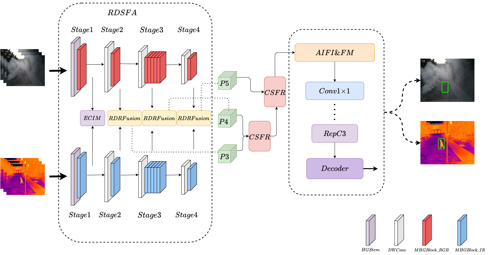

<div align="center">

# RDSFA-Net

### Recurrent Dual-Domain Alignment and Degradation-Guided Fusion for RGB-Infrared Object Detection

Guohua Lv, Jihao Jin, Yongbiao Gao, Yi Zhai

[](LICENSE)
[](https://www.python.org/)
[](https://pytorch.org/)
[](https://github.com/ultralytics/ultralytics)

</div>

---

## 📣 News

- **[2026-10]** Code, model configurations and training scripts of **RDSFA-Net** are released.

## ✨ Highlights

RDSFA-Net is a progressive RGB-IR detection framework that follows an explicit
**align → estimate → recover → fuse** paradigm. Instead of assuming that the two
spectral modalities are perfectly registered and equally informative, it
explicitly corrects the cross-modal geometry and suppresses spatially varying
modality degradation before fusion.

- **ECMI (Early Cross-Modal Interaction)** exchanges spatial attention and channel
  affinity right after the first backbone stage, so that every subsequent stage of
  both branches is already cross-modally aware.
- **RDSFA (Recurrent Dual-Domain Spectral Feature Alignment)** predicts multi-scale
  deformable offsets with three dilated branches, weights them with a
  squeeze-and-excitation strategy, and aligns RGB and IR features in a
  bidirectional symmetric manner. The alignment can be iteratively refined and is
  coupled with cross-scale feedback.
- **EDRF (Enhanced Degradation-Guided Recovery Fusion)** estimates five per-pixel
  degradation factors, performs degradation-gated recovery, and recombines shared
  and private features through a dynamic modality gate, preventing degraded signals
  from contaminating the fused representation.
- **CSFR (Cross-Scale Feature Refinement)** propagates high-resolution fusion
  results as priors to refine coarser scales in a coarse-to-fine manner.

<div align="center">

<p><em>Overview of RDSFA-Net. A dual-branch HGNet backbone extracts RGB and IR
features in parallel; ECMI, RDSFA, EDRF and CSFR are inserted along the
align-estimate-recover-fuse pipeline, and an RT-DETR decoder produces the final
detections.</em></p>
</div>

## 📊 Main Results

Reported with 640×640 inputs on a single NVIDIA A800 GPU. mAP values are
COCO-style.

| Method | Backbone | Data | LLVIP mAP50 | LLVIP mAP50:95 | M3FD mAP50 | M3FD mAP50:95 | DVTOD mAP50 |
|---|---|---|---|---|---|---|---|
| RT-DETR (RGB only) | HGNetv2 | RGB | – | – | 87.4 | 56.8 | – |
| RT-DETR (thermal only) | HGNetv2 | IR | – | – | 85.6 | 55.0 | – |
| RT-DETR-Concat (baseline) | HGNetv2 | RGB+IR | – | – | 87.4 | 56.8 | 82.0 |
| **RDSFA-Net (Ours)** | HGNetv2 | RGB+IR | **97.9** | **66.9** | **91.8** | **62.0** | **85.6** |

| Model | Params | FPS | M3FD mAP50 | M3FD mAP50:95 | DVTOD mAP50 |
|---|---|---|---|---|---|
| RT-DETR-Concat | 66.4 M | 41.2 | 87.4 | 56.8 | 82.0 |
| **RDSFA-Net (Ours)** | 120.0 M | 32.6 | **91.8** | **62.0** | **85.6** |

Compared with naive feature concatenation, RDSFA-Net improves M3FD mAP50 by
**+4.4** points and DVTOD mAP50 by **+3.6** points while still running in real
time. The largest gains are observed on the **misaligned** DVTOD benchmark, which
directly reflects the benefit of the bidirectional symmetric alignment.

## 🗂 Repository Structure

This repository is a cleaned release built on top of
[yolo-multimodal](https://github.com/Limiiiing/yolo-multimodal), a multimodal
fork of [Ultralytics](https://github.com/ultralytics/ultralytics) 8.3.13.

```
RDSFA-Net/
├── ultralytics/
│   └── nn/
│       ├── AddModules/
│       │   └── RDSFA.py                  # ★ ECMI / RDSFA / EDRF / CSFR implementation
│       └── tasks.py                      # ★ module registration in parse_model()
├── improve_multimodal/rtdetr/
│   ├── rtdetr-l-midfusion-RDSFA-Pro.yaml # ★ paper model (~130M params, 500 queries, 8 layers)
│   └── rtdetr-l-midfusion-RDSFA.yaml     # lite variant without ECMI / CSFR
├── train.py / train_pro.py               # training entry points
├── val.py / val_pro.py                   # validation entry points
├── predict.py                            # inference / visualization
├── datalvip.yaml                         # LLVIP   dataset configuration
├── datam3fd.yaml                         # M3FD    dataset configuration
├── datadvtod.yaml                        # DVTOD   dataset configuration (misaligned)
├── assets/overview.png                   # architecture figure
└── INTEGRATION.md                        # how to port RDSFA into your own fork
```

The files marked with ★ are the ones contributed by this work; the remaining
code comes from the upstream projects listed in
[Acknowledgements](#-acknowledgements).

## 🔧 Installation

```bash
git clone https://github.com/<your-account>/RDSFA-Net.git
cd RDSFA-Net

conda create -n rdsfa python=3.8 -y
conda activate rdsfa

# PyTorch (please pick the build matching your CUDA version)
pip install torch torchvision --index-url https://download.pytorch.org/whl/cu118

pip install -r requirements.txt
pip install -e .
```

Verify the installation:

```bash
python -c "from ultralytics import RTDETR; m = RTDETR('improve_multimodal/rtdetr/rtdetr-l-midfusion-RDSFA-Pro.yaml'); print(sum(p.numel() for p in m.model.parameters()) / 1e6, 'M params')"
```

## 📁 Dataset Preparation

RDSFA-Net is trained on three RGB-IR benchmarks: **LLVIP** (aligned, low-light
pedestrian detection), **M3FD** (aligned, six categories) and **DVTOD**
(**misaligned** drone-view benchmark).

Every sample is a registered pair of one visible and one infrared image. The
dataloader only reads the visible image list and derives the infrared path through
an `ir_replace` rule, so the two modalities must share file names.

```yaml
# datalvip.yaml
path: /path/to/LLVIP/     # dataset root, edit this line
train: images/train       # visible images used for training
val: images/val           # visible images used for validation
ir_replace: ['images', 'image']   # images/xxx.jpg -> image/xxx.jpg
nc: 1
names:
  0: person
```

For DVTOD the visible and infrared folders are `vis1` and `ir1`:

```yaml
ir_replace: ['vis1', 'ir1']
nc: 3
names: {0: person, 1: car, 2: bicycle}
```

Expected layout:

```
LLVIP/
├── images/{train,val}/*.jpg     # visible
├── image/{train,val}/*.jpg      # infrared (same file names)
└── labels/{train,val}/*.txt     # YOLO format, shared by both modalities
```

## 🚀 Training

The paper model corresponds to `rtdetr-l-midfusion-RDSFA-Pro.yaml`.

```bash
# LLVIP
python train_pro.py --data llvip

# M3FD
python train_pro.py --data m3fd

# DVTOD (misaligned)
python train_pro.py --data dvtod
```

Multi-GPU training with DDP:

```bash
CUDA_VISIBLE_DEVICES=0,1 torchrun --nproc_per_node=2 train_pro.py --data m3fd
```

A single-dataset configuration is also provided in `train.py`; edit the `data`,
`project` and `name` fields before running `python train.py`.

## ✅ Validation

```bash
python val_pro.py --data m3fd --weights runs/train/RDSFA-Pro/M3FD_Pro/weights/best.pt
```

or directly with the Ultralytics API:

```python
from ultralytics import RTDETR

model = RTDETR("runs/train/RDSFA-Pro/M3FD_Pro/weights/best.pt")
model.val(data="datam3fd.yaml", imgsz=640, batch=16, split="val", device="0")
```

## 🔍 Inference

```python
from ultralytics import RTDETR

model = RTDETR("runs/train/RDSFA-Pro/M3FD_Pro/weights/best.pt")
model.predict(
    source="datasets/M3FD/images/val",  # only list the visible images;
    save=True,                          # the infrared pair is loaded automatically
    conf=0.25,
    iou=0.5,
)
```

## 🧩 Integration into Your Own Codebase

If you already have a multimodal Ultralytics fork and only want the proposed
modules, copy two files and register three model classes:

1. Copy `ultralytics/nn/AddModules/RDSFA.py` into your `ultralytics/nn/AddModules/`.
2. Add `from .RDSFA import *` to `ultralytics/nn/AddModules/__init__.py`.
3. Register the output channels in `ultralytics/nn/tasks.py`:

```python
elif m in {RDSFusion, RDRFusion}:
    c2 = ch[f[0]]
    args = [ch[f[0]]]
elif m is CrossModalInteraction:
    c2 = ch[f[0]] * 2          # concatenated RGB + IR
    args = [ch[f[0]]]
elif m in {SplitRGB, SplitIR}:
    c2 = ch[f] // 2            # split back into the two modalities
```

4. Copy `improve_multimodal/rtdetr/rtdetr-l-midfusion-RDSFA-Pro.yaml` and use it as
   the model definition.

See [`INTEGRATION.md`](INTEGRATION.md) for the complete delta and for the module
signature list.

## 📌 Model Zoo

| Model | Params | LLVIP mAP50:95 | M3FD mAP50:95 | DVTOD mAP50 | Checkpoints |
|---|---|---|---|---|---|
| RDSFA-Net (Pro) | 120.0 M | 66.9 | 62.0 | 85.6 | *coming soon* |

## 📖 Citation

If you find this work useful, please consider citing:

```bibtex
@article{lv2026rdsfanet,
  title   = {RDSFA-Net: Recurrent Dual-Domain Alignment and Degradation-Guided Fusion for RGB-Infrared Object Detection},
  author  = {Lv, Guohua and Jin, Jihao and Gao, Yongbiao and Zhai, Yi},
  journal = {IEEE Transactions on Circuits and Systems for Video Technology},
  year    = {2026}
}
```

Please also cite the upstream projects this code builds on:

```bibtex
@software{yolov8_ultralytics,
  author  = {Glenn Jocher and Jing Qiu},
  title   = {Ultralytics YOLO},
  year    = {2023},
  version = {8.0.0},
  license = {AGPL-3.0},
  url     = {https://github.com/ultralytics/ultralytics}
}
```

## 🙏 Acknowledgements

This repository could not exist without the following open-source projects:

- [Ultralytics](https://github.com/ultralytics/ultralytics) — the detection
  framework that RDSFA-Net is built upon (AGPL-3.0).
- [yolo-multimodal](https://github.com/Limiiiing/yolo-multimodal) by *Limiiiing* —
  the multimodal fork that extends Ultralytics to RGB-IR inputs; the multimodal
  dataloader, the RT-DETR fusion configurations and the comparison fusion modules
  (ICAFusion, CFT, PSFM, DEYOLO, ...) originate from this project. Its original
  README is kept as `README_yolo-multimodal.md`.
- [LLVIP](https://bupt-ai-cz.github.io/LLVIP/),
  [M3FD](https://github.com/JinyuanLiu-CV/TarDAL) and
  [DVTOD](https://github.com/VTI-Yan/DVTOD) — the benchmarks used in this work.
- [MMDetection](https://github.com/open-mmlab/mmdetection) and
  [RT-DETR](https://github.com/lyuwenyu/RT-DETR) — reference implementations that
  inspired parts of the design.

## 📄 License

This project is released under the **AGPL-3.0** license, inherited from
Ultralytics. Any use of this code, in whole or in part, must comply with that
license. See [`LICENSE`](LICENSE) for details.